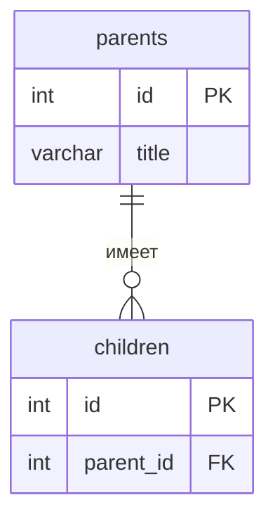

<!--
  Это шаблон README проекта. После создания своего репозитория:
  1. Переименовать репозиторий в backend-<фамилия>-<тема>, например backend-ivanova-library.
  2. Заполнить разделы ниже под свою тему и удалить этот комментарий.
  Задания лаб лежат в папке docs/, начинать с docs/README.md.
-->

# Backend: Онлайн-курсы

Тема №12: **Онлайн-курсы**. Сервис для управления каталогом образовательных курсов, позволяющий добавлять, просматривать и редактировать информацию о занятиях. Предназначен для студентов и преподавателей.

|                          |                           |
| ------------------------ | ------------------------- |
| Главная сущность         | Курс (Course)             |
| Связанная сущность (1:N) | ...                       |
| Фишка                    | ...                       |
| Стек                     | Python, FastAPI, Pydantic |

## Как запустить

```bash
# 1. Клонировать репозиторий
git clone https://github.com/DKrey06/Backend-Kretov-Online_courses.git
cd Backend-Kretov-Online_courses

# 2. Создать и активировать виртуальное окружение
python -m venv venv
.\venv\Scripts\activate

# 3. Установить зависимости
pip install -r requirements.txt

# 4. Запустить сервер
uvicorn main:app --reload
```

Сервис работает на `http://localhost:8000`. Запросы для демонстрации лежат в `requests.http`.

## Эндпоинты

| Метод  | Путь                | Что делает               | Ответ                               |
| ------ | ------------------- | ------------------------ | ----------------------------------- |
| GET    | `/health`           | Проверка, что сервис жив | 200 `{"status":"ok"}`               |
| POST   | `/api/courses`      | Создать курс             | 201 и объект с `id`; 400 при ошибке |
| GET    | `/api/courses`      | Список курсов            | 200                                 |
| GET    | `/api/courses/{id}` | Получить однин курс      | 200; 404                            |
| PATCH  | `/api/courses/{id}` | Частично изменить        | 200; 400; 404                       |
| PUT    | `/api/courses/{id}` | Полностью заменить       | 200; 400; 404                       |
| DELETE | `/api/courses/{id}` | Удалить                  | 204; 404                            |

## ER-диаграмма

<!-- С лабы 2. Блок mermaid GitHub рисует сам. -->



## Интерфейс

<!-- С лабы 4: скриншот, например  -->
